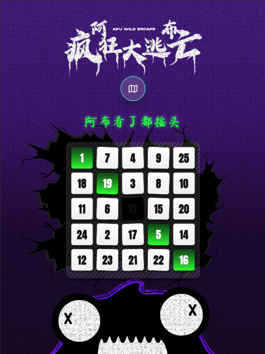
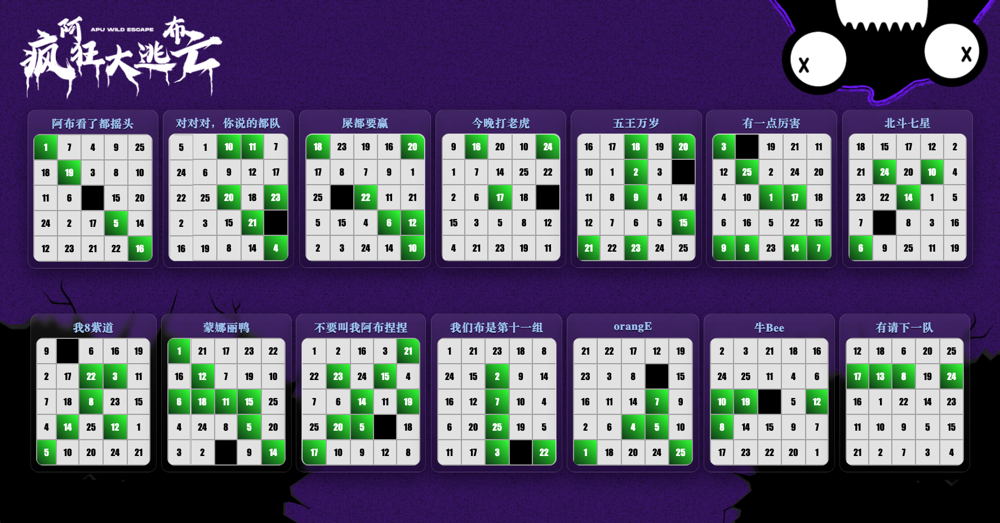
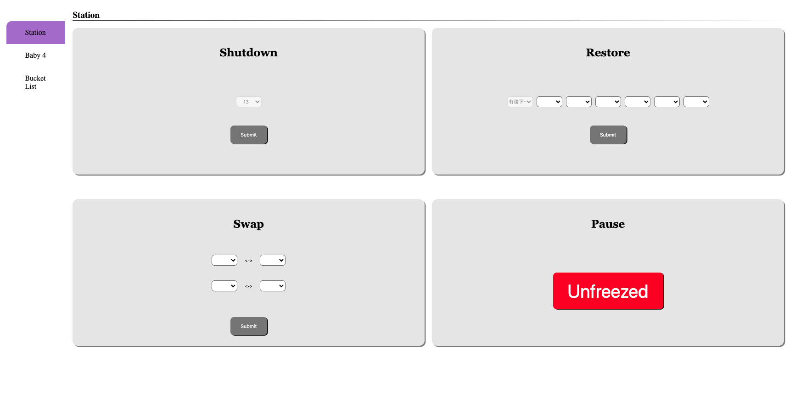
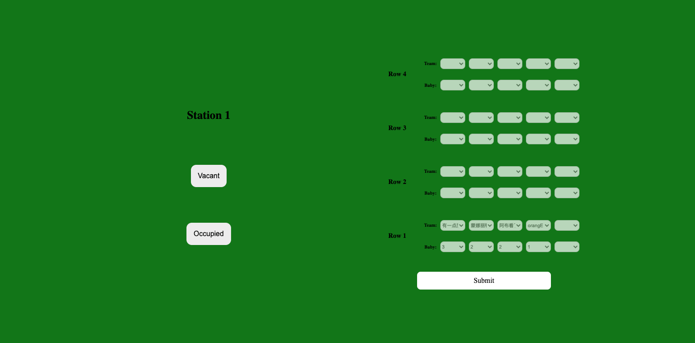
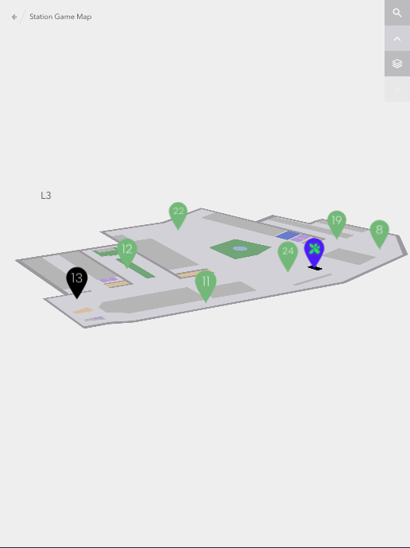

# APU Wild Escape

**A multi-role, browser-based event platform for a campus station game.**

APU Wild Escape was developed to support a team-based event at Asia Pacific University (APU). The platform connects participants, Game Masters, and administrators through an interactive number board, an overview of team progress, station-management controls, and a multi-level campus map.

This repository preserves the original event application and serves as a software engineering portfolio project.

**[Explore the participant page](https://xuanzs.github.io/htmls/guest.html?team=1)** · **[View source code](https://github.com/xuanzs/xuanzs.github.io)**

> **Demo note:** The linked participant page opens a specific team view from the original event. Some actions rely on the original Firebase data and event state and may not be available in a read-only portfolio demonstration.

## Overview

The application supports three main roles:

| Role | Main capabilities |
| --- | --- |
| **Participant** | Arrange numbers on a 5 × 5 board before submitting; view earned stations and blocked stations; open the campus station map. |
| **Game Master** | Record teams' successful station attempts; mark a station as vacant or occupied so its availability can be reflected on the map. |
| **Administrator** | Manage event operations and special game effects, including station shutdown, restoration, swapping, and pausing/unpausing. |

An additional **group overview page** presents the progress boards of multiple teams in one place.

## Screenshots

### 1. Participant Board
Players configure a 5×5 station board before the event. Green indicates completed station challenges, while black indicates blocked stations.



### 2. Group Progress Overview
Displays the progress of multiple teams, allowing organisers to monitor completed and blocked stations.



### 3. Administrator Dashboard
Enables organisers to manage special game actions such as station shutdown, restoration, swapping and pausing.



### 4. Game Master Dashboard
Allows Game Masters to record successful station challenges and update station occupancy.



### 5. Interactive Campus Map
Displays station locations and availability, with green for vacant, red for occupied and black for shut-down stations.



## How the game works

1. **Set up a team board.** Participants arrange station numbers on a 5 × 5 board. Once submitted, their arrangement is locked for the event.
2. **Play station challenges.** Teams visit campus stations to participate in games.
3. **Record progress.** Game Masters record which teams successfully complete a station challenge. Completed stations appear in **green** on the participant board and group overview.
4. **Apply special game effects.** Administrators can apply relevant event actions. For example, a station may be blocked or shut down through game mechanics.
5. **Check station availability.** Participants can use the campus map to find stations and view their current availability.

### Understanding the colours

The colour meanings depend on the screen:

| Screen | Colour | Meaning |
| --- | --- | --- |
| Participant and group boards | **Green** | Station challenge successfully completed by the team |
| Participant and group boards | **Black** | Station blocked or locked by a special game effect |
| Station map | **Green** | Vacant station |
| Station map | **Red** | Occupied station |
| Station map | **Black** | Shut-down station |

## Main interfaces

### Participant board

- A 5 × 5 number board configured by the team before the game.
- A submitted board that can no longer be rearranged.
- Visual progress showing completed and blocked stations.
- A map button linking to the campus station map.

### Group overview

- Multiple teams' boards presented together.
- An event-wide snapshot of completed stations and blocked positions.
- Designed to make progress easy to compare during the event.

### Game Master dashboard

- Station-specific management interface.
- Records team and station results through selection controls.
- **Vacant / Occupied** controls to update the station's availability, reflected in the shared station map.

### Administrator dashboard

Provides event-management controls for special game situations, including:

- **Shutdown:** disable a selected station.
- **Restore:** reactivate or restore a station or game state.
- **Swap:** apply a swap action to selected game elements.
- **Pause / Unpause:** control a game pause state.

These controls were designed for Game Masters and organisers running the original event rather than public visitors.

### Interactive campus map

- A layered view of the APU campus with station location markers.
- Colour-coded station availability (vacant, occupied, or shut down).
- Helps teams decide which station to visit next.

## Technology stack

- **Frontend:** HTML, CSS, JavaScript
- **Backend services / data:** Firebase and Cloud Firestore
- **Hosting:** GitHub Pages

The application was built as a web project for an event, without requiring a separate Java or Spring Boot backend.

## Repository layout

The repository includes web pages and supporting assets in directories such as:

```text
htmls/    Web interfaces (participant, group overview, admin, Game Master)
css/      Page styling
js/       Frontend behaviour and Firebase integration
img/      Visual assets
map/      Campus map resources
sound/    Game audio assets
public/   Additional public resources
```

Key page paths used during the event include `htmls/guest.html`, `htmls/View.html`, `htmls/admin.html`, and `htmls/gm.html`.

## Running locally

Open the repository in a local web server (for example, the VS Code Live Server extension), then visit:

```text
/htmls/guest.html?team=1
```

Some interfaces use the original Firebase project and may require data or access permissions that are not part of a read-only portfolio demo. Avoid submitting test data to the original event database.
  
## Portfolio and access note

This is an archived event project presented for demonstration and code review. The original application included role-specific event controls and Firebase-backed state. **A public URL does not mean that admin operations or database writes are intended for visitors.** Before advertising any interactive demo as safe for unrestricted public use, verify Firestore and Storage rules and restrict legacy credential-based access.

## Potential future improvements

- Rate limiting for hundreds of users visiting the map.
- Firebase Authentication and role-based authorization if organiser logins are needed again.
- Automated tests for board validation and station-state changes.

## 3D Campus Map — Adaptation and Integration

The interactive campus map in APU Wild Escape was adapted from the [3D Mall Map repository](https://github.com/ZaLiTHkA/3d-mall-map), which is based on the original [Interactive 3D Mall Map by Codrops](https://github.com/codrops/Interactive3DMallMap).

The original project provided the foundational layered 3D map interface and navigation functionality.

For APU Wild Escape, the map was customised and integrated into the event management platform, including:

- Adapting the original shopping mall layout to represent APU campus floors (L3–L8).
- Replacing store-related information with numbered game stations and their campus locations.
- Introducing station availability indicators: green for vacant, red for occupied and black for shut down.
- Integrating station status updates from the Game Master and Administrator interfaces.
- Adapting the sidebar to organise stations according to their game status.

The original map's design and foundational implementation are credited to their respective creators. The adaptations and game-specific integrations were developed for APU Wild Escape.

**Original sources:**
- [3D Mall Map — GitHub](https://github.com/ZaLiTHkA/3d-mall-map)
- [Interactive 3D Mall Map — Codrops](https://github.com/codrops/Interactive3DMallMap)
- [Codrops Licensing](https://tympanus.net/codrops/licensing/)</
